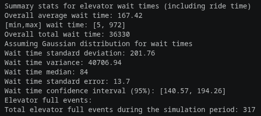
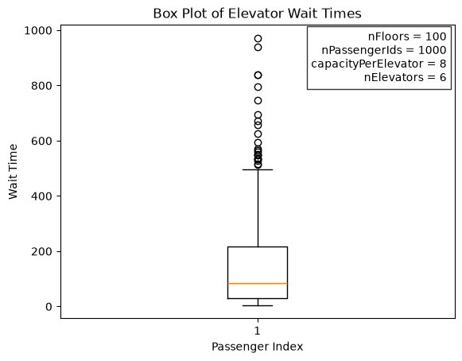
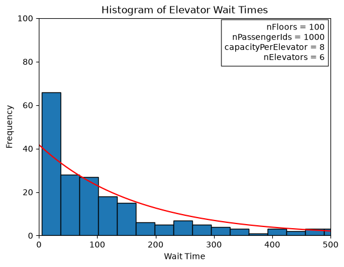

# Elevator simulation

This codebase simulates and analyses the operation of an elevator - a pick-up/drop-off problem.

## Quickstart

First-time setup:

```bash
# ensure "python" is available on your OS's path

# create a virtual environment in elevator/.env
python3 -m venv .venv

# activate the virtual Python environment
source .venv/bin/activate

# install Python dependencies
python -m pip install -r requirements.txt
```

Now generate some simulation input data by running this bash script:

```bash
./scripts/generateInputData.sh --help

./scripts/generateInputData.sh --nPassengerIds 1000 --nFloors 100 --simulationLength 1000 --busyPeriod 100:200:2 --busyPeriod 900:1000:3 > input.csv 
```

*Note: `shuf` (GNU coreutils) is required*


```bash

# Now open the Jupyter notebook

python -m jupyterlab elevator.ipynb
# alternatively, use VSCode extension for Jupyter notebook development

# ---> run the simulation from Jupyter

# observe the histogram and box plot at the end of the notebook

# swap out the scheduling alogithm {strategy_scan, strategy_intelligent, strategy_zoneBased} and observe the changes

# outputs (elevator_position_history.csv and summary_stats.txt) can be viewed in:
ls -altr ./out/
```

The elevator position log ("elevator_positions_log.csv") has one row per epoch, from 0 through the largest input time (inclusive) and one column per elevator; without a time column.

## Results

You should see output similar to:







## Time spent

3 hours

## Assumptions, simplifications, trade-offs


## Future

A rules-based Python program may get very complex when a lengthy list of rules need to be considered, making the code hard to understand and maintain as rules evolve. For example, while a rules-based Python program that is reasonably smart at selecting the nearest elevator, the elevator may already be carrying passengers heading elsewhere and any rules-based program should factor this in to its logic.

An optimisation-based approach can position elevators with a view to satisfying an objective such as minimising waiting time, without having to resort to a complext rules-based approach. For example, in the Python algorithm in this repo it does not choose a slightly farther elevator if that produces less total delay across everyone affected, whereas the optimiser would take that into consideration.

An optimisation-based approach was explored for a smaller problem size (fewer elevators, fewer floors, no express elevator routes) with some promising initial ouput.

The major drawback with the optimisation-based approach is the computational power needed and the time needed to find an optimised solution. A time limit was applied which just goes with the best currently available plan. 

Another area of interest is elevator safety: Elevators are safety-critical systems that transport humans and it would be very intersting to explore and understand the hard limits that must be applied to any elevator system and the imact of these hard bounds on any optimisation algorithm.

## Constraint-based optimisation approach

See [cbo/README.md](./cbo/README.md) for a constrained route-insertion optimizer.

```bash
cd cbo
cargo run --release --manifest-path Cargo.toml -- --global --solver-seconds 5
```

This reads `input.csv` and stores an optimised elevator position route log in `cbo/out/elevator_positions_log.csv`. 

By default, it uses a heuristic, not a globally optimal solver. Add `-- --global` to jointly optimize currently known requests using branch-and-bound, with a (default) 60-second limit per arrival-epoch solve and explicit optimality status. It never considers future arrivals (look-ahead).

---

### Notes

```text
Basement? (shift floors)

x express elevators - sparse matrix definition

id cards and restricted floor access

Some passengers more likely than others (VIPs)?

door opening/closing times

elevator speedup/slowdown times - increase amount of quantisation. differing floor heights

elevator energy usage

If lift is moving fast, cannot stop within X number of floors

elevator capacities

safety considerations

fire/evacuation

etc.
```